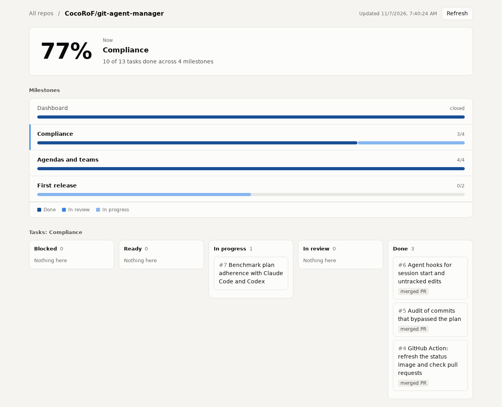

# git-agent-manager

<!-- gam:start -->
[](https://cocorof.github.io/git-agent-manager/)
<!-- gam:end -->

Connect once, and any coding agent working in your repo follows a milestone plan, while progress shows up on a live dashboard.

[한국어](README_ko.md)

Nothing new to learn, and nothing extra in your repo:

- **A milestone is a GitHub Milestone. A task is a GitHub Issue.** There's no new branch, file format, database or account. Repos that already use milestones work right away.
- **State is computed, not stored.** A task with a branch is in progress, one with an open PR is in review, and one closed by a merged PR is done. It can't drift out of sync.
- **You stay in the screens you know.** Reorder or comment on an issue from your phone, and agents see it on their next call.
- **Remove it and you keep ordinary issues and milestones.**

## Quick start

Inside a GitHub repo's folder, with Node 20 or later:

```bash
npx git-agent-manager
```

It works on one repo at a time, and refuses to run outside one. It:

1. Uses the GitHub login you already have (`GITHUB_TOKEN`, `gh`, or git credentials) and checks you can write to the repo.
2. Connects Claude Code in this folder right away.
3. Opens one pull request that connects every agent working in the repo: `.mcp.json` for Claude Code, `.codex/config.toml` for Codex, and a short pointer in `AGENTS.md` that Codex, Cursor and others read. It also adds a progress card to the README, and a workflow that serves the dashboard from the repo's own GitHub Pages.

Then just ask your agent for what you want:

> Plan out a billing system for this repo, then start on it.

## How agents use it

Agents get six small tools, about 1,000 tokens in all, over MCP or the `gam` CLI.

| Tool | What it does |
|---|---|
| `gam_status` | Where the plan stands, and what to do next |
| `gam_plan` | Creates milestones and tasks, or closes finished milestones |
| `gam_claim` | Takes a task and returns its branch and done-when list |
| `gam_update` | Adds a line of progress to a single comment on the issue |
| `gam_finish` | Submits evidence and opens a PR that closes the issue |
| `gam_block` | Marks a task blocked and says what's needed from a person |

Every result ends with a `next:` line. That's how agents stay on track without long instruction files.

**Agents can't take the same task.** Claiming creates the task's branch, and GitHub lets only one caller create a given branch. Twenty agents racing for one task produces one winner.

**Small work stays small.** `gam_claim` with `new` records an unplanned fix in one call, so nobody needs to edit the plan to fix a typo.

## The dashboard



Each repo's dashboard is its own. It's served from the repo's GitHub Pages, at `https://<owner>.github.io/<repo>/`, or from your own domain if you've set one in the repo's Pages settings. [This repo's dashboard](https://cocorof.github.io/git-agent-manager/) is an example.

- The page shows only the repo it was made for. It reads the plan live from the GitHub API, so it's redeployed only when the tool updates.
- If the repo already uses GitHub Pages for something else, connect leaves it alone. Build the dashboard with `gam site <folder>`, host it anywhere, and put `dashboard: <url>` in `.github/gam.yml` so links point there.
- `gam site <folder> --repos you/a,you/b` makes one page for several repos, to host on your own domain.
- Private repos get no public dashboard. Run `gam dashboard` for a local HTML file, or host `gam site` output where only you can reach it. That page asks for a read-only token, which stays in the browser.
- It shows commits that went around the plan, unplanned work, and whether each finished task was proven by a merged PR.

The README card lives on a hidden ref (`refs/gam/status`), so it doesn't appear in your branch list, clones, or commit history. Private repos get a link instead, because an anonymous image request can't read them.

## Staying on plan

Going off plan is never blocked by default. It's made visible. You choose how far to go:

| Level | What it adds | Where it works |
|---|---|---|
| Guidance | MCP instructions and `next:` lines | Everywhere |
| Audit | Commits with no task are counted on the dashboard | Everywhere |
| Hooks | Claude Code gets the plan at session start, and is asked once about untracked work | Claude Code |
| PR check | A warning on PRs with no task, unmet criteria or open blockers | Any repo with the workflow |
| Merge block | Set the check as required, with `mode: strict` | Public repos, or GitHub Pro and up |

### Does it work?

We ran fixed jobs on a small scratch repo and scored the result from GitHub, not from what the agent said. With the setup above, in repos with a plan:

| Agent | Work stayed on the plan |
|---|---|
| Claude Code | 12 of 12 runs |
| Codex | 6 of 6 runs |
| Codex with MCP alone, no `AGENTS.md` | 0 of 6 runs |

These are short jobs on a tiny repo, a few runs each. Long sessions in big repos aren't measured yet. [Details and method](docs/BENCHMARK.md).

### Settings

All optional, in `.github/gam.yml`:

```yaml
approval: required                      # new tasks from agents wait until a person removes the "proposed" label
merge: agent                            # gam_finish may merge a PR once its checks pass
dashboard: https://plan.example.com/    # where links to the dashboard point
```

## Agendas

Hand agents a goal in one sentence:

```bash
gam agenda "Analyze three competitors and propose next quarter's pricing"
```

The next agent to check status breaks it into milestones and tasks. With roles (`role:*` labels and the `GAM_ROLE` variable), a team of agents picks up the work meant for each of them, and they're warned when their branches touch the same files. The agenda closes itself when its milestones do.

## Running it inside your own platform

Platforms that run agents for others, and decide for themselves who may do what, can call the CLI with `--repo owner/name --json` and a token in `GITHUB_TOKEN`. Every result and every failure comes back as one JSON object.

- `GAM_AGENT` names the agent, and `GAM_ROLE` steers it to `role:*` tasks.
- `gam approve <issue>...` puts proposed tasks into play, for whoever your platform lets approve.
- `GAM_ALLOW_MERGE=1` lets `gam finish --merge` merge for that call, whatever `.github/gam.yml` says. Set it only for agents your platform allows to merge.

## Security

On a public repo, anyone can open an issue, so an issue is a way to try to steer your agent.

- **Only tasks in a milestone count**, and setting a milestone needs triage access.
- **Issues and comments from people without write access are never handed over as work.** Their comments are left out and only counted.
- **Issue text is marked as data** in everything agents receive.
- **The dashboard builds its page from text nodes** under a strict Content Security Policy, only ever calls `api.github.com`, and only shows the repos it was built for.
- **Plans on public repos are public.** Keep secrets out of issues.

## Limits

- GitHub only for now. The core sits behind one interface, and GitLab and Gitea have the same concepts.
- Only people and agents with write access can claim tasks.
- Cursor and Gemini haven't been through the benchmark.
- Agents using the same GitHub account all appear as you. Each signs its progress comment with its own name, and `GAM_AGENT` sets that name.

## Develop

```bash
npm ci
npm test
npm run build
GAM_E2E=1 GAM_E2E_REPO=you/scratch-repo npm run test:e2e   # wipes that repo's plan
```

`dist/` is committed, because the Action runs from it. The design is in [docs/PLAN.md](docs/PLAN.md) (Korean).

## License

[Apache 2.0](LICENSE)
